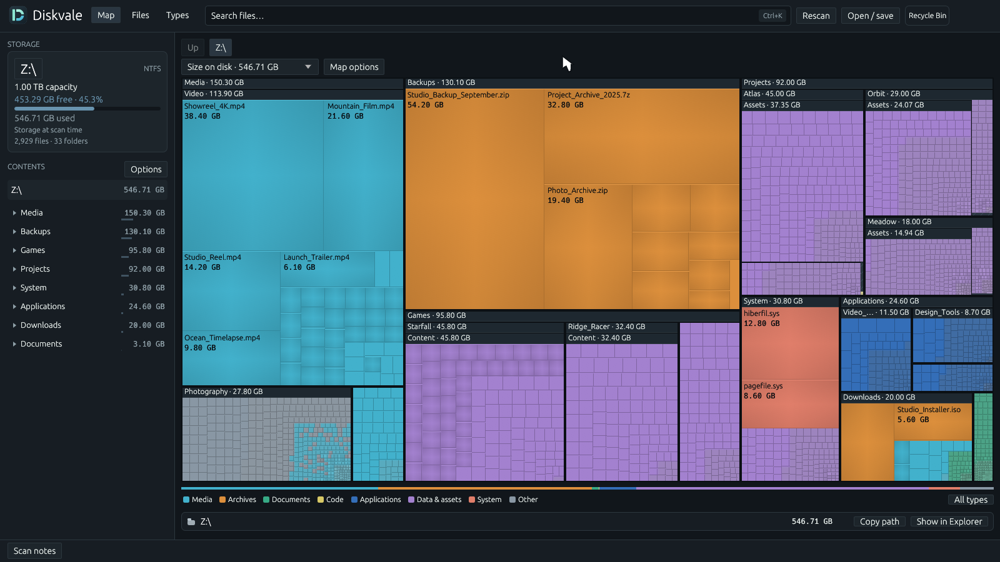
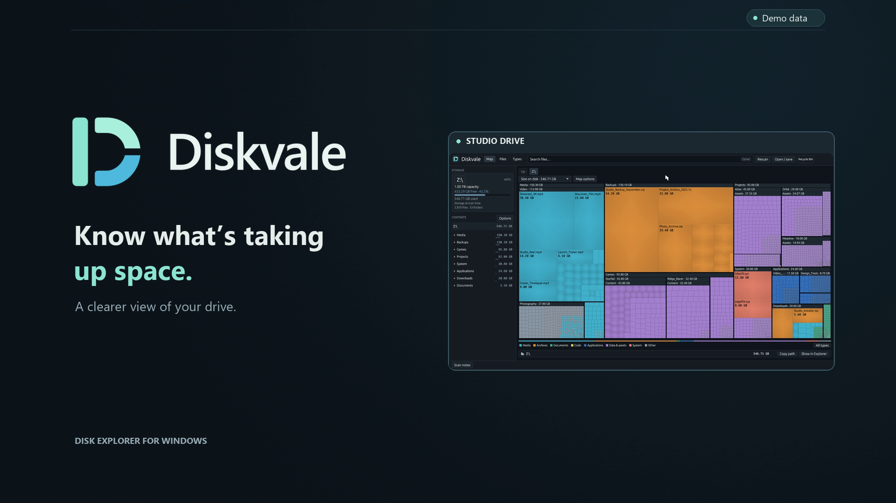

<picture>
  <source media="(prefers-color-scheme: dark)" srcset="assets/brand/diskvale-logo.png">
  
</picture>

**Disk space, clearly.** An open-source Windows disk explorer built in Rust.

Diskvale turns an NTFS drive into an interactive map so you can see what takes up space, find large files, and explore folders. It runs locally as a native desktop application.

[Download for Windows](https://github.com/colin-automates/Diskvale/releases/latest) · [Watch the 30-second demo](https://colin-automates.github.io/Diskvale/) · [How it works](#how-it-works) · [Build from source](#build-from-source)



## Download and run

| Download | What you get |
| --- | --- |
| [Windows x64 portable ZIP](https://github.com/colin-automates/Diskvale/releases/latest/download/Diskvale-windows-x64.zip) | Diskvale.exe, a quick-start guide, MIT license, and third-party notices. Recommended. |
| [Diskvale.exe](https://github.com/colin-automates/Diskvale/releases/latest/download/Diskvale.exe) | Standalone application, with no installer. |
| [Source ZIP](https://github.com/colin-automates/Diskvale/archive/refs/heads/main.zip) | Full project source, tests, assets, documentation, and demo tooling. Each release also has source archives for its exact version. |

1. Download the portable ZIP and extract it.
2. Open `Diskvale.exe` and approve the Windows administrator prompt.
3. Select an NTFS drive and click **Scan**. Use **Rescan** to refresh existing results.

Requires **Windows x64**, an **NTFS drive**, and **administrator access** to read the NTFS index. Launching the app does not automatically scan a drive. No Rust, Python, Node.js, or browser installation is needed to run the downloaded application. Releases are currently unsigned; Windows may show an unknown-publisher warning.

SHA-256 checksums accompany each release. From PowerShell, `Get-FileHash .\Diskvale.exe -Algorithm SHA256` prints the executable's checksum.

## Demo

[](https://colin-automates.github.io/Diskvale/)

**[Watch the 30-second video](https://colin-automates.github.io/Diskvale/)** · **[Download the MP4](https://github.com/colin-automates/Diskvale/releases/latest/download/Diskvale-Demo.mp4)**

The tour uses the actual application UI with a generated studio drive. Demo source and rendering instructions are in [tools/demo-video](tools/demo-video/README.md).

## What you can do

- **Map:** explore a nested treemap where area represents size and color represents file category. Individual files have shaded tiles; grouped files use a textured tile and file-count badge.
- **Files:** browse the largest files in the current folder and its descendants. Sort by size or modification date.
- **Types:** see storage totals by extension. Click a color category to isolate it across views.
- **Search:** combine names, extensions, sizes, and ages. Press **Ctrl+K** to focus search.
- **Inspect:** hover to see a name, file size, and location. Double-click a folder or press **Enter** to open it; **Backspace**, **Up**, and breadcrumbs navigate back.
- **Save and compare:** save JSON snapshots, export CSV, and compare against an earlier snapshot of the same drive.
- **Clean up:** right-click an individual file or folder and choose **Delete…**. Confirm the exact target to move it to the Recycle Bin. If Windows cannot recycle it, a separate confirmation offers permanent deletion. Drive roots and grouped tiles cannot be deleted. Rescan after changes; recycled files still occupy space until the Bin is emptied.

| Search | Matches |
| --- | --- |
| `ext:mp4 >1GB` | MP4 files larger than 1 GB |
| `archive <500MB` | Names containing “archive”, smaller than 500 MB |
| `older:1y` | Files last modified more than 365 days ago |
| `ext:zip newer:30d` | ZIP files modified within the last 30 days |

Size filters use the selected size metric. GB/MB/KB are decimal; GiB/MiB/KiB are binary. Age units are days (`d`), weeks (`w`), 30-day months (`m`), and 365-day years (`y`). Files without a recorded date do not match age filters. Search and category filters follow you into folders.

## How it works

1. **Read the NTFS index.** Diskvale opens the selected volume for reading and reads its Master File Table in 8 MiB chunks. It validates record boundaries, sector fixups, and file references, and resolves fragmented mappings and attribute-list extensions. It does not walk every file through Explorer or follow reparse targets.
2. **Build a tree.** Records become an indexed parent/child tree. Logical lengths, allocated data runs, modification times, and hard-link information are collected, then file counts and sizes are aggregated through folders.
3. **Lay out the map.** A squarified treemap divides the available area into nested rectangles. Small files can be grouped without discarding their bytes. Drawing and pattern geometry have budgets to keep very dense maps manageable.
4. **Prepare results in the background.** Scanning, filtering, file lists, and extension totals use background work. Cached results and virtualized tables reduce repeated work when switching views. The same search predicate drives the map and tables.
5. **Keep disk operations explicit.** Scanning reads metadata. Save/export writes only the chosen output file. Deletion is a separate confirmed Windows operation that revalidates the selected target before acting.

### Understanding the sizes

**File size** is logical data length. **Size on disk** is allocated storage from NTFS data runs. Sparse holes do not count toward allocation; resident data has no separately allocated clusters. Named streams are included. Multiple hard links share one allocation, assigned to one encountered path, so allocation attributed to an individual folder can depend on the link used.

Directory index allocation and other volume overhead are excluded from file totals. A complete, allocation-known scan with captured capacity/free-space data can show **Outside indexed files** for the remaining used space. A live scan is not an atomic filesystem snapshot, so changes during a scan can affect totals.

### Current scope

Diskvale is an early release with an **experimental NTFS reader**. The application scans whole NTFS drives; it does not scan arbitrary folders, network shares, or other filesystems. Opening a folder in the map explores the existing drive index. Unsupported or malformed metadata returns an error instead of silently falling back to another scanner.

Large drives can require substantial memory. Full-volume correctness and performance parity with other disk tools has not been established. Live USN updates and duplicate-file discovery are not implemented.

## Build from source

Install [Rust through rustup](https://rustup.rs/) and [Visual Studio Build Tools](https://visualstudio.microsoft.com/downloads/#build-tools-for-visual-studio) with **Desktop development with C++** and a **Windows SDK**. `rust-toolchain.toml` selects stable Rust for Windows MSVC; the minimum supported Rust version is 1.88.

```powershell
git clone https://github.com/colin-automates/Diskvale.git
cd Diskvale
powershell -ExecutionPolicy Bypass -File scripts/build_release.ps1
Copy-Item .\target\release\canopy.exe .\Diskvale.exe
```

`canopy` is the historical internal crate/binary name. The product, executable branding, and window title are Diskvale. The Windows SDK resource compiler embeds the app icon, version information, and administrator manifest. All application artwork is embedded in the executable.

The release script runs `cargo build --release --locked` with compiler path remapping so published executables do not contain the build machine's profile or checkout paths. An ordinary local `cargo build --release --locked` also builds the application.

Builds and ordinary tests work from a standard terminal. Launching the production app, including debug builds, requires administrator access. Use an administrator terminal for `cargo run` or CLI scans.

```powershell
cargo fmt --all -- --check
cargo test --locked
cargo clippy --locked --all-targets -- -D warnings
```

Tests cover synthetic NTFS records, accounting, queries, layout, cached results, and deletion confirmation/revalidation. Tests that perform Windows deletion on disposable fixtures and the large saved-scan timing check are ignored by default. See [CONTRIBUTING.md](CONTRIBUTING.md).

To package a portable release after building:

```powershell
powershell -ExecutionPolicy Bypass -File scripts/package_release.ps1
```

The package, standalone executable, and checksums are written under `artifacts/release/`. Building the application does not require the optional Python/Node demo or artwork tools.

### Command-line examples

From an administrator terminal:

```powershell
.\Diskvale.exe --path "C:\" --compact
.\Diskvale.exe --path "C:\" --auto-scan
.\Diskvale.exe --scan "C:\" --json scan.json --csv files.csv > scan-summary.json
.\Diskvale.exe --snapshot scan.json --view largest
```

`--compact` uses a 1050×700 window; `--view largest` and `--view types` choose a results tab. `--focus "Projects"` focuses a relative path within loaded results. The release uses the Windows GUI subsystem; redirect output for headless scans. `--mft-file saved.mft` is a diagnostic parser input; `--snapshot scan.json` opens saved results. The production executable still requires an administrator token for these modes.

## Source layout

| Path | Responsibility |
| --- | --- |
| `src/scanner/mft/` | Bulk NTFS reader, record validation, and tree construction |
| `src/model.rs` | Indexed tree, paths, totals, and scan metadata |
| `src/treemap.rs` | Squarified nested map layout and grouped tiles |
| `src/query.rs`, `src/file_types.rs` | Search predicates and color categories |
| `src/ui.rs`, `src/ui/` | Native egui interface, navigation, tables, and background result caches |
| `src/recycle.rs` | Confirmed, revalidated Windows recycling/permanent deletion |
| `src/main.rs`, `build.rs` | Startup, administrator checks, icon, and Windows resources |
| `tests/`, `examples/` | Regression tests, saved-scan UI preview, and synthetic demo capture |
| `assets/brand/`, `tools/demo-video/` | Editable branding and reproducible demo production |
| `scripts/` | Release packaging, resource checks, and license notices |

The legacy filesystem walker in `src/scanner/` is retained for library regression tests; desktop and CLI scan routes use the bulk NTFS reader exclusively. Diskvale is an independent project and does not include WizTree code or binaries.

## License and contributions

Diskvale's original source, branding, and demo are available under the **[MIT license](LICENSE)**. Dependencies and embedded fonts retain their own licenses, recorded in [THIRD_PARTY_NOTICES.txt](THIRD_PARTY_NOTICES.txt) and included in portable releases.

[Report a bug or suggest a feature](https://github.com/colin-automates/Diskvale/issues), or submit a pull request. For scan bugs, share a minimal synthetic reproduction or redacted diagnostics; scan snapshots and CSVs contain file names and paths.
